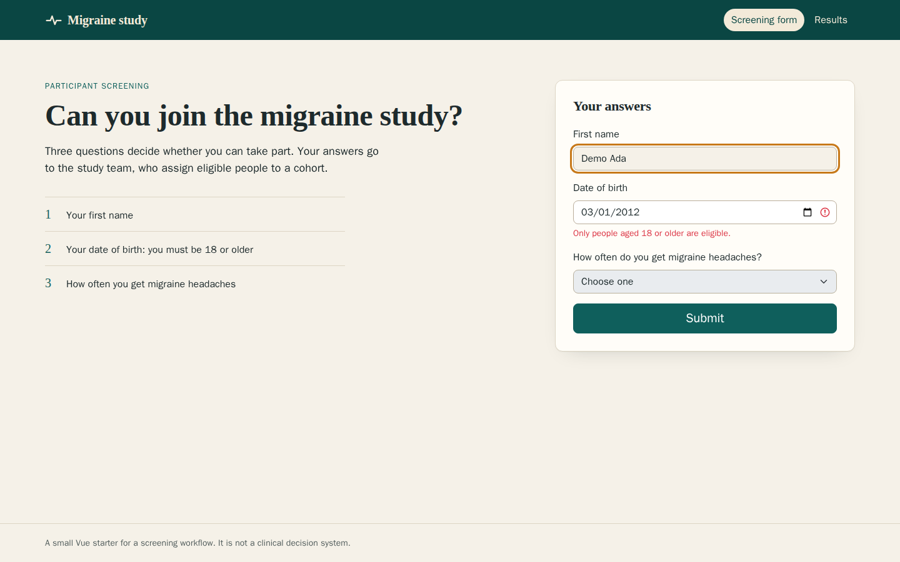
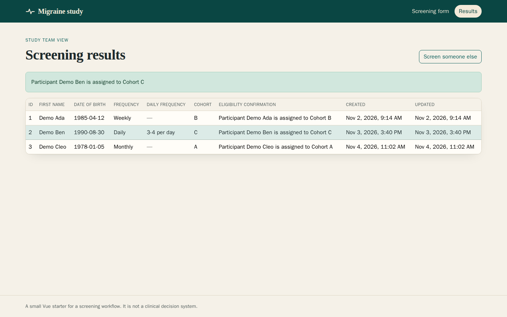
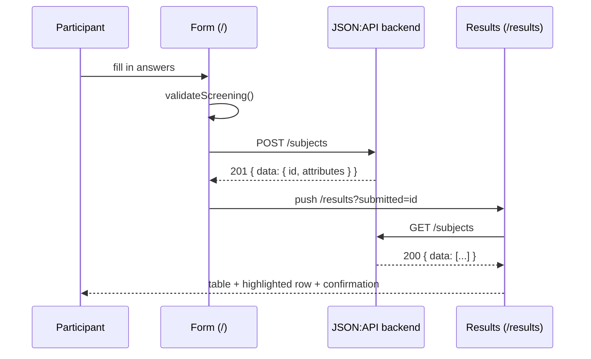

# Vue Screening Form

A small Vue 3 single-page app for a clinical-trial screening workflow: a
participant fills in a three-question form, the answers are posted to a
JSON:API backend, and a results page lists everyone screened so far with the
cohort the backend assigned.

It is a frontend starter, not a production screening or clinical decision
system. The backend that stores subjects and decides eligibility is **not part
of this repository**; the app expects one at `VITE_API_BASE_URL`.

| Screening form                                                                       | Results after a submission                                                                 |
| ------------------------------------------------------------------------------------ | ------------------------------------------------------------------------------------------ |
|  |  |

Mobile views: [form](docs/screenshots/form-mobile.png),
[results](docs/screenshots/results-mobile.png). The screenshots use made-up
demo records served by a mocked API.

## What it does

- **Screening form** (`/`): first name, date of birth and migraine frequency,
  plus a daily count when the answer is "Daily". The frequency question stays
  disabled until the date of birth shows the person is 18 or older. Answers
  are validated in the browser before anything is sent, and server-side
  JSON:API errors (`errors[].detail`) are shown as they come back.
- **Results** (`/results`): a table of every subject with labels instead of
  codes, formatted timestamps and the backend's eligibility confirmation.
  It has loading, empty and error states (with a retry button).
- **Hand-off between the two**: after a successful submit the app opens
  `/results?submitted=<id>`, highlights that row and shows its confirmation.
  Only the id is in the URL, and the confirmation is read back from the API,
  so a refresh keeps it. Unknown or malformed ids get a warning.



## Running it

Requires Node 22 (see `.nvmrc`) and npm.

```bash
npm ci
cp .env.example .env.local   # then point VITE_API_BASE_URL at your backend
npm run dev                  # http://localhost:5173
```

Other scripts:

```bash
npm test          # Vitest + Vue Test Utils (jsdom), no backend needed
npm run lint      # ESLint (eslint-plugin-vue) and a Prettier check
npm run build     # production bundle in dist/
npm run preview   # serve dist/ locally
```

Without a backend the form shows "Could not reach the screening API at …" and
the results page shows the same message with a retry button.

### Docker

The `Dockerfile` runs the tests and the build in `node:22`, then serves `dist/`
from `nginx:1.30-alpine` as the unprivileged `nginx` user on port 8080, with a
fallback to `index.html` so deep links such as `/results?submitted=12` work.
The API URL is baked in at build time:

```bash
docker build --build-arg VITE_API_BASE_URL=https://api.example.test/api/v1 -t vue-screening-form .
docker run --rm -p 8080:8080 vue-screening-form   # http://localhost:8080
```

The backend must allow CORS from wherever the app is served.

## API contract

Everything goes through `src/api/subjects.js` with
`Accept: application/vnd.api+json`. These are the shapes the app sends and
reads; they come from the code and tests, not from a live backend.

```http
POST /subjects
Content-Type: application/vnd.api+json

{ "data": { "type": "subjects", "attributes": {
    "first_name": "Ben", "date_of_birth": "1990-08-30",
    "frequency": 3, "daily_frequency": 2 } } }
```

`frequency` is 1 = monthly, 2 = weekly, 3 = daily. `daily_frequency`
(1 = 1-2, 2 = 3-4, 3 = 5+ a day) is only sent when `frequency` is 3. The app
reads `data.id` from the 201 response. `GET /subjects` should return
`data[]` with `first_name`, `date_of_birth`, `frequency`, `daily_frequency`,
`cohort`, `eligibility_confirmation`, `created_at` and `updated_at`
attributes. Missing attributes render as a dash.

## Layout and design notes

```
src/
  api/subjects.js     fetch client, JSON:API headers, ApiError
  screening.js        validation, 18+ cut-off, option labels, payload shaping
  components/         TheScreeningForm.vue, TheResults.vue
  router/index.js     two routes, unknown paths redirect to the form
  styles.css          palette and type over Bootstrap 5.3 CSS variables
tests/                Vitest suites for the client, rules, both views, routing
```

- The age check compares local `YYYY-MM-DD` strings, so it does not drift by
  a day around midnight UTC and handles 29 February without date arithmetic.
  It is a convenience; the backend should still enforce eligibility.
- Components use the Options API, as the original code did.
- Bootstrap is used as plain CSS; the look comes from overriding its CSS
  variables rather than a Sass build.
- Accessibility: every control has a label, field errors are linked with
  `aria-describedby`, the error summary takes focus, results and notices use
  `role="status"`, and focus moves to `<main>` on navigation.
- Participant data is not stored in the browser; the API is the only source.

## License

MIT, see [LICENSE](LICENSE).
